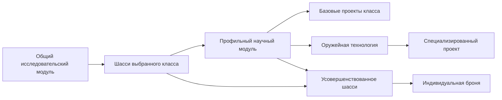

# Новотаиидане: разбор научного дерева и служебных кораблей

22 октября 2026. **Предложение на согласование. Игровая реализация, установленная e67bd447… и Новокушане не изменялись.** Пользователь просит оценить новую схему, сверить HW2 Classic и утилитарные корабли обеих рас; реализацию Новотаиидан начать после согласования. Радаа планируется представлять кораблями Новотаиидан и обычных вэйгров, без отдельной полноценной игровой расы Радаа.

Буквальный пользовательский черновик, включая исходные EN/сокращения: [NEOTAIIDAN_RESEARCH_DRAFT_2026-10-22.txt](../reference/NEOTAIIDAN_RESEARCH_DRAFT_2026-10-22.txt). Это сохранённый источник, не исправленная спецификация. Старые общие решения: [NEOTAIIDAN_DESIGN.md](NEOTAIIDAN_DESIGN.md). Научная сборка из шести секций, одна очередь и отдельная станция сохраняются; дополнительные функции станции не назначаются автоматически.

## Оценка основы и сравнение с HW2 Classic

Схема годится как основа. По допускам это классовая система, по сочетанию общего и индивидуального усиления — гибрид двух рас HW2. У Новокушан один проект собирает технологии разных инженерных киитов; у Новотаиидан основная работа сосредоточена внутри своего класса. Различие стоит сохранить, не создавая обязательной лестницы «истребители → корветы → фрегаты → эсминцы».

| Свойство | HW2 Classic | Новотаиидане: предложенный черновик |
|---|---|---|
| Научная инфраструктура | Hgn: Research1500RU/75с, Advanced2250/150; Vgr: Research500/30 | Общая секция и пять профильных; цены пока не заданы |
| Открытие классов | У Vgr платные Corvette/Frigate Chassis открывают производственные модули; классы независимы | Шасси есть, но условия профильных секций и кораблей их пока не используют |
| Улучшения | Hgn преимущественно для отдельных типов; Vgr — общие классовые I/II | Общая продвинутая ступень класса и частные броня/скорость: подходящее авторское сочетание |
| Экономика/тыл | Есть улучшения ресурсных кораблей, крупных кораблей и производства | Броня экономики/производство предусмотрены; Материнскому кораблю не хватает прочности и скорости |
| Производство | Отдельная оплата инфраструктуры, открытия и самого корабля; научная очередь общая | Научные секции не заменяют производственные возможности конкретного строителя |
| Число обычных исследований | Hgn69, Vgr39, текущие Новокушане57 | В черновике65 узлов; количество не определяет цену доступа к нужному составу |

65 узлов распределены как13/8/8/9/12/15: общий/истребители/корветы/фрегаты/эсминцы/платформы. Самая широкая специализированная ветка — платформенная, включающая также генераторы и сенсоры. Это заметный общий инфраструктурный выбор, но не циклическая зависимость.

Числа Classic проверены по локально извлечённым исходным таблицам, не по памяти и не по Remastered: [справочник](../HW2_CLASSIC_RESEARCH.md), `local/novokushan/hw2classic-research.json`. Инженерные эффекты Новокушан сверены с текущим подготовленным `local/campaign-speech/source/scripts/races/Kushan/scripts/def_research.lua` и снимком `fleet-preview/`; они совпали. Подробный машинный аудит: `local/neotaiidan/research-review-20261022/audit.json`.

## Связи, которые надо определить до реализации

### 1. Базовые шасси открывают профильные секции — принято

Корабли зависят от наличия профильных модулей, а все пять профильных модулей требуют только общий. У Fighter/Corvette/Frigate/Destroyer/Platform Chassis нет явно указанного эффекта или допуска. Связь с их Advanced-версиями между разными модулями также нужно записать явно.

**Подтверждено Дмитрием22 октября:** общий модуль → шасси класса → профильный модуль → корабли. Базовое шасси — платное открытие соответствующей секции, без дополнительного бонуса. Секция после постройки допускает базовые проекты класса, специализированные проекты дополнительно требуют оружейную/специальную технологию. Advanced Chassis требует базовое шасси и даёт согласованный классовый бонус. Получается близко к логике классового допуска Vgr, хотя у нас речь о научных секциях, а не заводах. Связь согласована, в игру ещё не внесена.

Для лёгкого истребителя исключение из черновика сохраняется: достаточно общего модуля. Другие классы не требуют последовательно открывать предыдущие классы.

### 2. Потеря лаборатории не отнимает открытые проекты — принято

Условие «корабль = модуль» может означать постоянное открытие проекта после постройки секции либо требование иметь живую секцию для каждого нового заказа. Это разные правила.

**Подтверждено Дмитрием22 октября:** как у Новокушан, после открытия проект остаётся доступен; потеря секции закрывает новые исследования её ветки, а выученные технологии и их бонусы сохраняются. Само открытие класса после постройки секции должно фиксироваться постоянно. Строительство уже открытого проекта не требует живую лабораторию на каждом новом заказе. Сохраняются прежние ограничения конкретного строителя: носитель не получает производство сверхтяжёлых кораблей.

Защита лабораторий остаётся осмысленной: потеря профильной секции мешает дальнейшему развитию до восстановления, но не отнимает инвестиции в уже открытую науку. Точное поведение текущего незавершённого исследования при потере секции — ожидание восстановления или иной штатный переход — отдельно проверять при реализации; пока не обещать конкретную нативную механику очереди.

### 3. Тяжёлый эсминец открывается значительно короче, чем у Новокушан

По черновику лёгкому достаточно эсминного модуля, тяжёлому — того же модуля и Heavy Guns. У Новокушан нужны обе продвинутые ступени шасси/двигателей; полный текущий научный доступ стоит6100RU без самого корабля. Конкретную разницу в RU для Новотаиидан считать рано: цены секций и исследований ещё не назначены.

**Предложение:** тяжёлый = эсминный модуль + Advanced Destroyer Chassis + Advanced Destroyer Drive + Heavy Guns. Альтернатива — оставить только Heavy Guns и сделать его достаточно дорогим поздним допуском. Не добавлять Battlecruiser Chassis: наш тяжёлый остаётся эсминцем с базой90000HP/HeavyArmour и прежним капом5. Лёгким сохраняется дополнительный кап10, общий Capital15.

### 4. Плазменная ветка и независимость классов

В черновике Plasma Bombs находится у истребителей и открывает бомбардировщик; штурмовой фрегат открыт своим модулем без плазменного исследования. Это допустимое отличие от инженерной схемы Новокушан, где общие Plasma Weapons нужны обоим.

**Предложение:** у Новотаиидан сохранить бомбардировочную ветку в истребительном модуле. Если улучшение плазмы нужно и штурмовому фрегату, добавить отдельные «Улучшенные плазменные заряды / Improved Plasma Charges» во фрегатную ветку. Не заставлять фрегатное развитие строить истребительную секцию ради чужого улучшения. Обычные пушки фрегата таким исследованием не усиливать. У Classic Improved Bombs — специальный боеприпас против подсистем; его открытие Hgn/Vgr стоит1500RU/45с.

### 5. Разграничить платформы, инженеров и ресурсные корабли

Вкладка строительства не задаёт автоматически ни семейство улучшений, ни общий лимит. В текущей пробе боевые платформы — Защитник и защитный истребитель; инженерные корветы занимают ту же вкладку, но имеют отдельный лимит20. Генераторы используют другую вкладку и общий пул18.

**Предложение для Новотаиидан:**

- Advanced Platform Chassis и Advanced Platform Drive относятся только к Защитнику и защитному истребителю.
- Индивидуальная броня ремонтного и абордажного корветов может исследоваться в платформенной лаборатории, но не даёт им автоматически ещё и общий платформенный бонус.
- Advanced Utility Ships Chassis в общем модуле назвать по-русски «Усовершенствованное шасси служебных кораблей» и в первом варианте отнести к сборщику/контроллеру, в соответствии с его дочерними узлами.
- Прочность/скорость инженеров и генераторов, если нужны, задавать явным списком целей; не смешивать их с экономикой одним неоговорённым общим бонусом.

Иначе ремонтник/абордажник могут попасть сразу под два улучшения шасси. В текущем Новокушанском дереве иной, уже существующий принцип: они получают корветные общие бонусы, Защитник — истребительные. Это не отсутствие улучшений, но такую асимметрию нужно учитывать при сравнении рас.

### 6. Производство и гипертуннели

Общий Improved Manufacturing и его индивидуальные дочерние узлы нуждаются в явно определённом эффекте. Нельзя случайно превратить общий×1.3 и частный×1.3 в обещанный конечный×1.3, если получится×1.69. Предложение: задать желаемые конечные ступени, например общая×1.15 и личная×1.30, затем проверить фактическое сочетание в движке. Альтернатива — общий узел только открывает две частные работы.

Для исследовательской станции в черновике нет улучшения производства. Его можно добавить позднее, по аналогии с Shipyard Manufacturing HW2, но станция остаётся дополнительным объектом, выпускающим корабли до фрегатов. Она не становится седьмым научным модулем и не получает производство эсминцев/носителей автоматически.

**Генератор гипертуннеля в списке кораблей — новый проект**, которого нет в текущем Новотаииданском строительстве. Рабочая интерпретация для согласования — парные гиперврата по принципу штатного `vgr_hyperspace_platform` с FormHyperspaceGateCommand. Это отличается от обычного гиперпрыжка Материнского/носителя. Не считать, что одно открытие способности уже создало новый корабль. Если нужен именно такой проект, отдельно определить корпус, цену, частный кап и расход общего пула; не отнимать у боевых Защитников их общий Platform4 из-за штатного капа вэйгровского прототипа. Принятый Generators18 без согласования не увеличивать.

## Найденные пропуски служебных кораблей

Это сравнение реально записанных эффектов Новокушан и предложений Новотаиидан. Оно не подтверждает работу всех модификаторов в движке.

| Корабль / группа | Новокушане сейчас | Новотаиидане в черновике | Рекомендация |
|---|---|---|---|
| Сборщик ресурсов | Нет HP/скоростных улучшений | Общее служебное шасси и личная броня | Добавить броню экономики обеим расам; корабли оставить доступными без науки |
| Ресурсный контроллер | Нет HP/скоростных улучшений | Общее служебное шасси и личная броня | То же; скорость — отдельное авторское дополнение, не обязательная копия Classic |
| Материнский корабль | Производство×1.3 и открытие гиперпрыжка; нет HP/скорости | Производство и гипертехнология; нет HP/скорости | Добавить броню и двигатель Материнского обеим расам |
| Носитель | Общие/личные шасси и двигатели, производство | Общие/личные шасси/двигатели и производство | Не пропущен; определить ступени производства |
| Ремонтник, абордажник | Есть открытие и общие корветные HP/скорость | Есть открытие и личная броня | Не пропущены; определить единственную общую научную группу |
| Защитник | Общие истребительные HP/скорость | Платформенные общие и личные HP, общий двигатель | Отличие группировки, а не потерянный проект |
| Сенсорная батарея | Открытие, пинг/антистэлс, гиперсенсоры; нет HP/скорости | Та же функциональная ветка; нет HP/скорости | Функции покрыты; живучесть генераторов — дополнительный выбор |
| Генераторы маскировки/гравиполя | Открытия есть, HP/скоростных работ нет | Открытия есть, HP/скоростных работ нет | По желанию одна общая живучесть генераторов, без россыпи частных исследований |
| Зонд, датчик приближения | Зонд свободный, датчик за технологией; частных улучшений нет | Аналогично | Отсутствие персональной брони здесь не обязательный пробел |
| Научные секции | Свободные открытия, без боевых модернизаций | Общая секция свободна, остальные за общим допуском | Собственные уровни брони пока не нужны |

Нативные опорные цены Classic, не автоматически новые цены нашего мода:

| Исследование Classic | RU / базовые секунды | Эффект |
|---|---|---|
| Hgn Resource Collector Health I / II |400/40;800/60 |×1.5 /×2.0 HP |
| Hgn Resource Controller Health I / II |500/30;1000/40 |×1.3 /×1.6 HP |
| Vgr Utility Health I / II |1200/50;2400/70 |×1.5 /×2.0 HP классу Utility |
| Hgn Mothership Health I / II |500/30;750/40 |×1.5 /×2.0 HP |
| Hgn Mothership Speed I / II |500/30;750/40 |×1.2 /×1.35 скорости |
| Mothership Manufacturing Hgn / Vgr |1000/60 у обеих |×1.3 производства |
| Carrier Manufacturing Hgn / Vgr |1500/60;1500/100 |×1.3 производства |

Стартовые HP, отряды и составы нашего мода отличаются от HW2: классические множители не переносить на90000HP тяжёлого эсминца или на четырёхаппаратный корветный отряд автоматически. Утверждённые пробные общие/частные уровни Новокушан пока1.15/1.30HP и1.10/1.25скорости; их нативное сочетание остаётся отдельным тестом.

## Минимальное дополнение Новокушанам для согласования

Не нужно превращать инженерные кииты в классовые модули.

- **Наабал:** шасси служебных кораблей → броня сборщика / броня контроллера. В первом варианте эти цели — только экономика; не давать инженерным корветам второй общий бонус. Здесь же отдельная броня Материнского корабля.
- **Манаан:** двигатель Материнского корабля. Скорости сборщика/контроллера можно добавить отдельно, если хотим осмысленную инвестицию в безопасность экономики, но это не обязательный элемент HW2 Classic.
- **Сомтаау:** если Новотаииданам принимаются индивидуальные ускорения производства, рассмотреть такие же конечные ступени носителя/Материнского у Новокушан; их существующий общий Improved Manufacturing уже даёт×1.3 и не должен молча удвоиться.
- **С’Джет, опционально:** снижение цены гиперпрыжка. В Classic у Hgn две ступени HyperspaceCost0.8/0.6. Нынешнее открытие гиперпрыжка есть, экономия не обязательна.
- **Сомтаау, опционально:** улучшение ремонтных систем поддержки/ремонтника, если нужен второй уровень полезности. Сам ремонт уже присутствует. В черновике Новотаиидан поддержка дополнительно требует Repair Systems; у Новокушан поддержка пока только за Frigate Drive. Синхронизировать допуск стоит лишь по отдельному согласию.

Не предлагаются как обязательные: ремонт ресурсерами HW2 (у нас есть собственные ремонтные единицы), EMP разведчика, ECM-зонд, ракеты платформ, копирование кораблей и новые боевые проекты ради полного повторения списка Classic.

## Названия RU/EN перед реализацией

- **Fire Control Systems** обычно означает «Системы управления огнём», а не «Системы подавления огня». Для исследования, открывающего именно защитный/ПРО-истребитель, возможна более конкретная пара «Противоракетные системы / Missile Defense Systems». Это предложение названия; исходная пара сохранена в буквальном черновике.
- Для личной брони эсминцев/носителя EN должен быть **Armor**: Light Destroyer Armor, Light Missile Destroyer Armor, Carrier Armor, Heavy Destroyer Armor. Chassis остаётся шасси/открытием и не подменяет личную броню; исходные EN-варианты не удалять.
- **Minelaying Technology**, не minelying; «Броня абордажного корвета / Salvage Corvette Armor» и «Броня ремонтного корвета / Repair Corvette Armor» точнее сокращённых Salvager/Repairer Armor.
- «ПРО-истребитель» пока разговорная роль из нового черновика; существующее отображаемое имя «Защитный истребитель / Defense Fighter» автоматически не переименовано. Все окончательные изменения в UI и глоссарии — после согласования; RU/EN готовить одновременно.

## Радаа: готовые корабли вместо новой игровой расы

Предложение пользователя принимается как направление: сюжетные Радаа получают обычные корабли Новотаиидан и вэйгров, без отдельной исследовательской/строительной расы Радаа. В сценах остаются их название, союзность, персонажи, реплики и сюжетные объявления. Модели/вооружение выбираются по роли; внешнее сходство не заменяет функциональное соответствие.

Это продолжает уже существующую карту `tools/prepare_minicampaign.py`: штурмовики/бомберы/копейщики Радаа → `vgr_interceptor/vgr_bomber/vgr_lancefighter`; фрегат/эсминец → `tai_assaultfrigate/tai_destroyer`; ракетный фрегат → `vgr_heavymissilefrigate`; гиперврата/верфь/линкрейсер/контроллер/пушечная платформа → штатные вэйгровские проекты. У Новотаиидан нет линкрейсера: для этой сюжетной роли остаётся Vgr Battlecruiser, а не переименование нашего тяжёлого эсминца.

Важная граница: `Ship_Rad_MissileFrigate` не надо превращать в захватчика только из-за похожего корпуса Infiltrator Frigate. Если нужны ракеты — использовать ракетную роль. У ракетного корвета также сохранить роль, а не автоматически давать многопушечный корвет по силуэту.

Для ещё не внесённой в эту MAP роли ракетного корвета первое предложение — обычный Vgr Missile Corvette. Это предложение соответствия, не уже сделанная замена в кампании.

Для первой версии NPC-флот можно выдавать сценарием и подкреплениями; не создавать смешанное автономное дерево науки/AI для Радаа. Это не меняет науку обычных вэйгров. Отдельные сюжетные объекты — эмиттеры щита, башня, разрушаемая станция и её секции — требуют собственного сценарного соответствия и не подменяются случайными кораблями. Они не означают необходимость новой игровой расы или механики копирования.

## Пакет решения перед реализацией

1. **Согласовано:** базовые шасси открывают профильные секции; лёгкий истребитель доступен с общим модулем.
2. **Согласовано:** открытые проекты и бонусы сохраняются после потери секции; дальнейшая наука ветки требует её восстановления.
3. Выбрать поздний допуск тяжёлого эсминца и разграничение групп общих бонусов.
4. Утвердить минимальную броню экономики/улучшения Материнского обеим расам; остальное оставить опциями.
5. Подтвердить, что новый генератор гипертуннеля — парные врата, и отдельно назначить ему корпус/лимит. Станция остаётся до фрегатов, а её прочие функции — на потом.

После этих решений можно считать полные RU/временные маршруты и готовить реализацию, сохраняя57-узловую основу Новокушан до отдельно согласованных дополнений. Ни сохранение пользовательского черновика, ни этот разбор не являются согласием установить модификацию.
